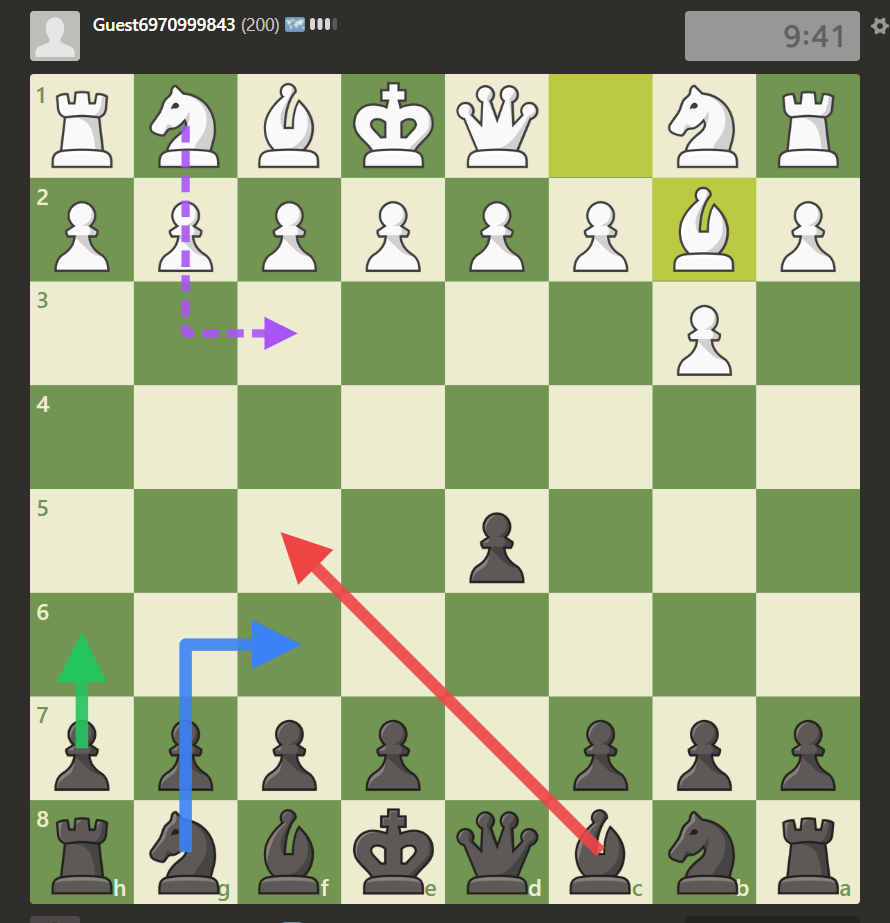

# Chess Analyzer



A lightweight, minimalist browser extension for real-time chess analysis.

> **Note:** A userscript version of this tool is also available in the [chess-userscript](https://github.com/peenjeee/chess-userscript) repository.

## Features

- Sites: Works on **chess.com**, **lichess.org**, and **endgame.ai**.
- Engine: Full-strength Stockfish 19 NNUE (~95MB, downloaded once and cached), with chess.com's built-in engine as a fallback.
- Lichess variants: King of the Hill, Three-Check, Antichess, Atomic, Horde, Racing Kings and Crazyhouse are analyzed by Fairy-Stockfish 14 with the variant's NNUE network, the engine lichess's own analysis uses ([lichess-org/stockfish-web](https://github.com/lichess-org/stockfish-web), ~0.7MB from jsDelivr, version-pinned and hash-checked). Each network is downloaded once from lichess's asset host (about 1MB for antichess and horde, 48MB for the others, 59MB for crazyhouse), checked against the hash in its name and cached. It needs threads, which lichess game pages allow; on pages that do not, the extension runs it in its own offscreen document (see chess.com variants below). If Fairy-Stockfish fails to start, the analyzer falls back to the single-threaded multi-variant Stockfish 10 ([lichess-org/stockfish.js](https://github.com/lichess-org/stockfish.js), GPLv3, ~0.6MB). Crazyhouse pockets and three-check counters are read from the page; a suggested drop shows as a ringed square with the piece letter. lichess variant games are not relayed: the web app follows them straight from lichess by username.
- chess.com variants (the 4 Player & Variants server): Crazyhouse, 3 Check, King of the Hill, Atomic, Giveaway, Horde and Racing Kings are analyzed by the same Fairy-Stockfish 14 and NNUE networks as the lichess variants. Torpedo, Sideways Pawns, Petrified, Seirawan Chess and Chaturanga run on the same Fairy-Stockfish with the Fairy-Stockfish project's own NNUE network for each (from its shared Google Drive folder, listed at [fairy-stockfish.github.io/nnue](https://fairy-stockfish.github.io/nnue/); about 48MB each, 80MB for Seirawan, checked against the hash in its name and cached), and Paradigm Chess30, which has no network, on Fairy-Stockfish's built-in evaluation. Duck Chess runs on the Fairy-Stockfish project's own build, since the lichess one has no duck chess, with the project's duck network (48MB, same source). These variants need the extension. If a network cannot be downloaded, that variant still runs on the built-in evaluation. No Castling, and Setup Chess once both sides have finished setting up, are standard chess for Stockfish 19. chess.com pages cannot run threads, so the extension runs Fairy-Stockfish in an offscreen document, a hidden extension page that can. That copy of the engine ships in `engine/` (`fsf_14.js` and `fsf_14.wasm` from `@lichess-org/stockfish-web` 0.5.0, AGPLv3, and the duck chess build in `engine/fairy-stockfish/` from `fairy-stockfish-nnue.wasm` 1.1.12, GPLv3, ~1.7MB), and the extension caches each network after its first download. If it cannot start, the lichess variants fall back to multi-variant Stockfish 10. Banked pieces (crazyhouse, Seirawan's hawk and elephant), petrified stones, the duck, the side to move and the checks given are read from the board and its move list; a suggested Seirawan gating move shows H or E on the square the piece leaves, and a suggested duck chess move rings the square the duck goes to. After you move a piece and before you place the duck, the arrows for your turn stay up. Any other variant there (Fog of War, Spell Chess, Blindfold, 4 Player, custom rules and so on) shows "Variant not supported" instead of arrows. Games of the supported variants are relayed with their variant, start position and moves, so the web app follows, analyzes and reviews them too.
- Chess960 (all three sites): the engine runs in Chess960 mode, with castling rights taken from the game's start position (looked up once per game from the site's own game API; on chess.com's variants server, read from the page). A suggested castle is drawn to the king's landing square, or as the rook's move when the king already stands there. A Chess960 game on the variants server is relayed with its start position and moves, so the web app follows it like any other game.
- Fast Parsing: Extracts FEN from the DOM instantly (piece classes on chess.com, piece transforms on lichess, square cells on endgame.ai).
- SecretQueen (endgame.ai): hidden queens (own square + revealed pieces from API/DOM badges) analyzed as queens. Features Secret Queen Threat Overlay (dashed danger lines & target beacons from all living opponent pawns) and auto-detection toast alerts when opponent pawns or their Secret Queen are captured. Both appear only once endgame.ai's API confirms the game is Secret Queen.
- Visual Overlays: Draws SVG arrows (Blue, Green, Red) to indicate top moves. Knights use L-shaped paths.
- Turn Detection: Automatically reads the current turn and board orientation.
- Pondering: Displays anticipated opponent replies via dashed lines.
- Live Relay: Press **Ctrl+Shift+C** or **Ctrl+Shift+X** to copy your **Relay ID** — enter it in the [Chess Analyzer web app](https://chess.0xpnj.dev) (**Live** tab → **Session ID**) to mirror your game with engine suggestions on another device, with a full Game Review when it ends. No persistent relay UI.
- Hotkeys: Show/hide the move suggestions with the 'A' key (starts/stops the analyzer), and hide or show the Analyze button with the 'Insert' key.

> `scripts/main.js` is generated from `userscript.js` in the [chess-userscript](https://github.com/peenjeee/chess-userscript) repository — edit it there.

## Installation

### 1. Clone the Repository
Open your terminal and clone the repository using Git:
```bash
git clone https://github.com/peenjeee/chess-analyzer.git
```

### 2. Load into Browser
1. Open your browser's extensions page (`edge://extensions/` or `chrome://extensions/`).
2. Enable "Developer Mode".
3. Click "Load unpacked" and select the extension directory.
4. The extension is now ready to use on supported pages.

## Usage

1. Open a chess game.
2. Press 'A' on your keyboard to toggle the analyzer overlay.
3. Follow the arrow guides on the board.
4. Press 'Insert' to hide or show the analyzer button (the 'A' hotkey keeps working while it is hidden).

## Troubleshooting

- **Analyzer is stuck or arrows don't appear:** If the engine stops responding or the arrows freeze, simply press the **'A'** key twice (to turn it off and on again). This will instantly reset the engine memory and resync it with the current board position.
- **"Engine unavailable":** the engine failed to load or crashed more than three times in a row (it restarts by itself before that — usually an interrupted ~95MB download). Press **'A'** twice to retry from scratch. In a lichess variant game it can also mean cdn.jsdelivr.net is blocked on your network.
